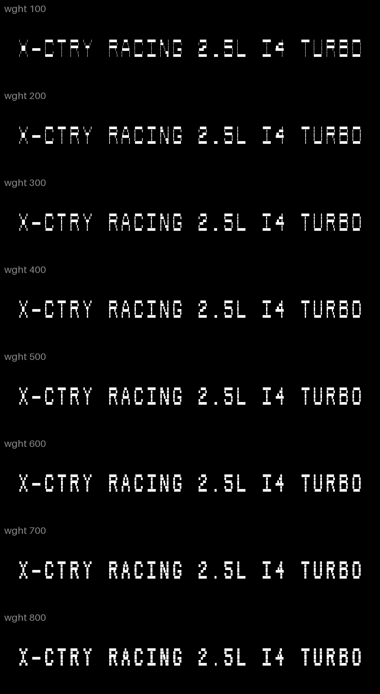
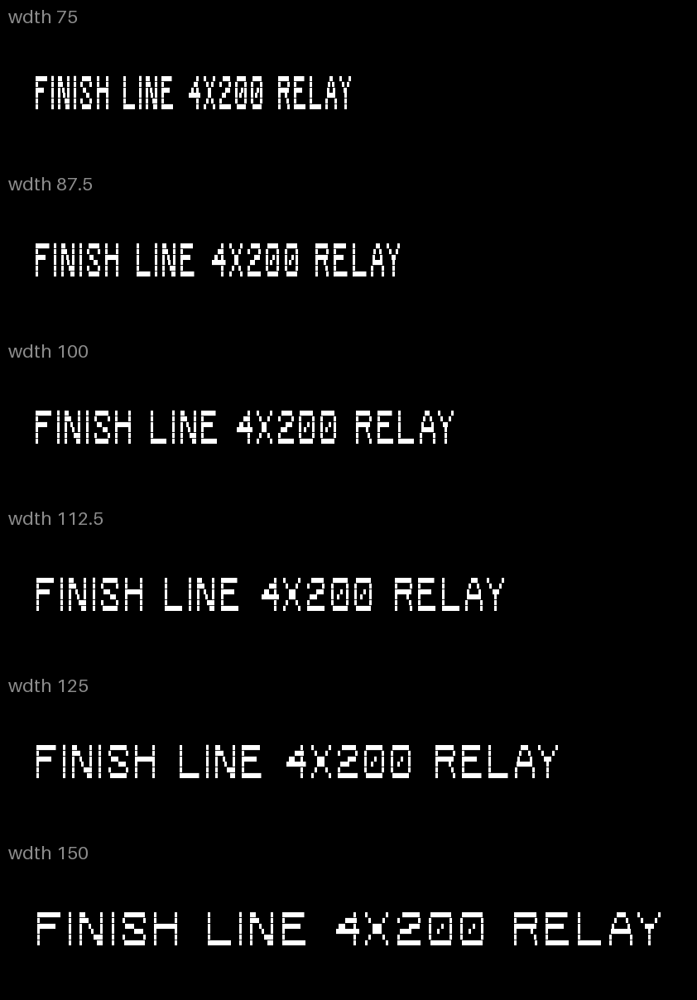
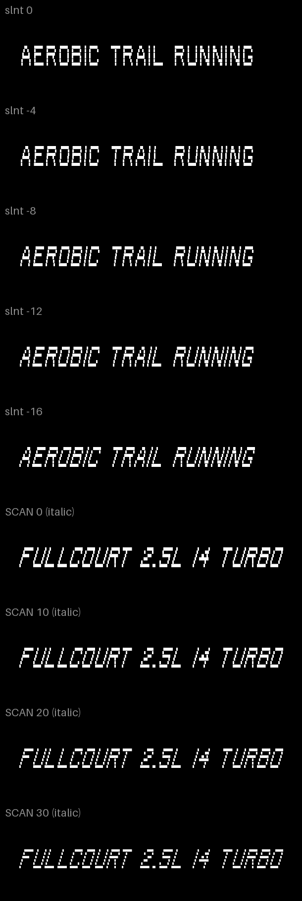
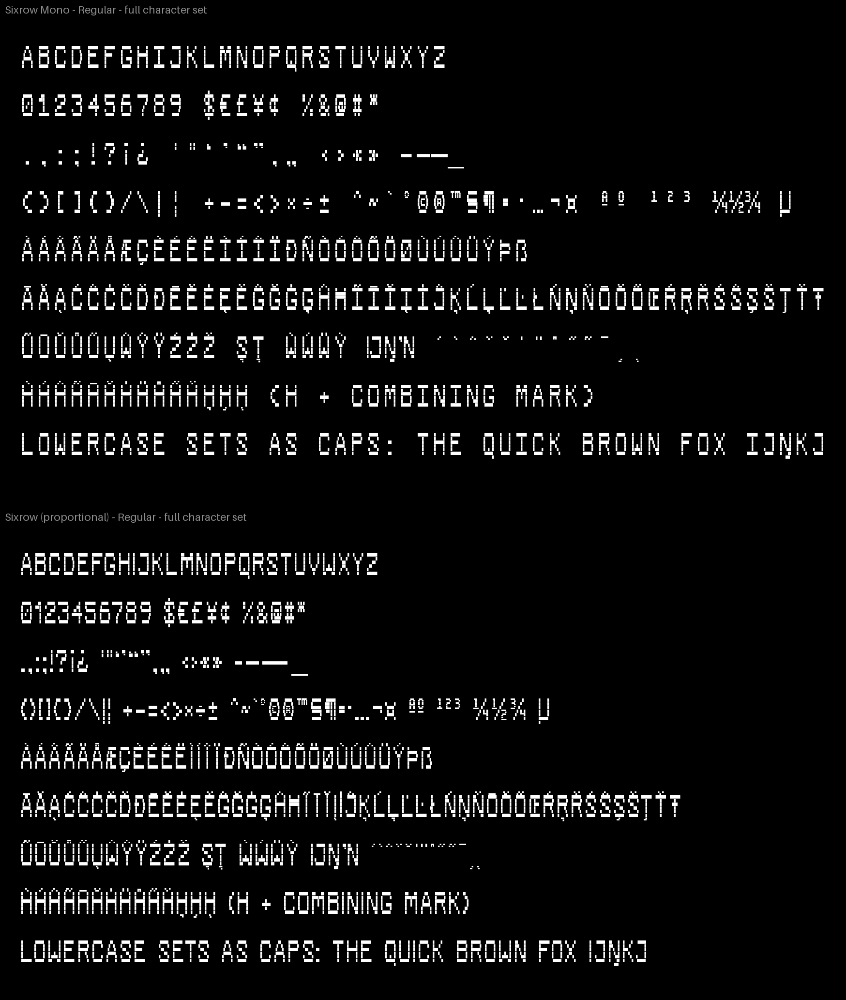

# Sixrow

Sixrow is a display typeface built on six rows. Every capital is drawn on a grid six rows tall, and the gap
between the rows is a variable axis. At 0 the strokes are solid. Open it and each letter splits into separate
horizontal lines. The other axes are weight (100 to 800), width (75 to 150) and slant (0 to −16°). The slant is
a stair step: each row shifts sideways while the strokes stay upright. Try it and download it at
https://www.excellent.so/type.

There are two families, Sixrow and Sixrow Mono. Each comes as a variable font and as 16 static styles, Thin to
ExtraBold in upright and italic, in TTF and WOFF2. The character set has 372 code points, the whole of Google
Fonts' Latin Core: A to Z, figures, punctuation, currency, and the accents for every European Union language
written in Latin and dozens more. It is capitals only, so lowercase text sets as capitals.

Every letter is a grid in a plain text file, and a script builds the fonts from those grids. No font editor is
involved. Sixrow is Excellent's house typeface. It is free for personal and commercial use under the SIL Open
Font License 1.1.






## Axes

| Tag | Axis | Range | Default | What it does |
|---|---|---|---|---|
| `wght` | Weight | 100–800 | 400 | Stem thickness. Bars always fill their row. |
| `wdth` | Width | 75–150 | 100 | Letter body and spacing. |
| `slnt` | Slant | −16–0 | 0 | Stair-step italic: each row shifts by tan(16°) of the row pitch. |
| `SCAN` | Scanline | 0–30 | 10 | Gap between the rows, as a percentage of the row pitch. 0 is solid. |

Static styles: Thin, ExtraLight, Light, Regular, Medium, SemiBold, Bold and ExtraBold, each with an italic, at
width 100 and scanline 10. Features: `ss01` swaps the slashed zero for a plain one; in Sixrow, `tnum` gives a
tabular 1, and `kern` holds 1,399 pairs generated from the letters' row profiles. Combining accents (U+0300…)
attach to every letter through `mark` and `mkmk`.

## Files

- `fonts/variable/`: `Sixrow[SCAN,slnt,wdth,wght].ttf`, `SixrowMono[SCAN,slnt,wdth,wght].ttf`, and WOFF2.
- `fonts/static/Sixrow/`, `fonts/static/SixrowMono/`: 16 styles each, TTF and WOFF2.
- `specimen/index.html`: an interactive specimen with the fonts embedded. Open it in a browser.

The release zip, with a printed specimen, is at https://www.excellent.so/type.

## Build

```sh
uv venv .venv --python 3.12 && uv pip install --python .venv/bin/python -r requirements.txt
.venv/bin/python tools/build.py       # → build/variable/*.ttf|woff2, build/static/<family>/*
.venv/bin/python tools/proof.py       # → proof/*.png: charset, axes, review sheets, overlay on the reference
.venv/bin/python tools/specimen.py    # → specimen/index.html
.venv/bin/python tools/images.py      # → release/images/*.png, release/new-glyphs.png
.venv/bin/python tools/package.py     # → release/Sixrow-1.000.zip, registry zips, CHECKSUMS.txt
```

The family name, version, credits, metrics and axis ranges live in `sources/config.toml`. The build is
reproducible: the same sources and the pinned packages in `requirements.txt` give byte-identical fonts.

## Editing glyphs

Glyphs are plain-text grids. Edit them and rebuild.

```
@ A src=sample
| ........########........
| .....####......####.....
| ...####..........####...
| ...##################...
| ####................####
| ####................####
```

- `sources/glyphs-mono.txt`: every drawing; the format is documented at the top of the file.
- `sources/glyphs-proportional.txt`: overrides for the proportional family. Everything else is the Mono drawing
  with its empty columns trimmed.
- `sources/composites.txt`: accented capitals, a letter plus a mark.
- `sources/combining.txt`: the combining marks, drawn from the same accents.
- `sources/config.toml`: names, metrics, axis ranges and spacing.

`src=sample` marks glyphs traced from the reference lettering in `reference/samples/`, which is Matt Waite's own
design. `src=draft` marks glyphs drawn to match by Claude, under Matt's direction. `FONTLOG.txt` lists them by
code point. Measurements are in [`docs/DESIGN-SPEC.md`](docs/DESIGN-SPEC.md).

## Licence

Copyright 2026 The Sixrow Project Authors. Sixrow is licensed under the SIL Open Font License, Version 1.1, with
no Reserved Font Name: see [`OFL.txt`](OFL.txt). The FAQ is at https://openfontlicense.org.

Designed by Matt Waite for [Excellent](https://www.excellent.so/type).
